<p align="center">
  
</p>

<h3 align="center">I'm Alejandro. Depending on who you ask, I'm Suito.</h3>

<p align="center">
  Software Engineering student at the University of Málaga.<br />
  I build backends for a living and climb mountains to recover from them.
</p>

<p align="center">
  <a href="https://alewuito.github.io/suitoportfolio/"><b>Climb the full portfolio</b></a>
  &nbsp;·&nbsp;
  <a href="https://www.linkedin.com/in/sui-to/">LinkedIn</a>
  &nbsp;·&nbsp;
  <a href="https://mail.google.com/mail/?view=cm&fs=1&to=alesuitto@gmail.com">alesuitto@gmail.com</a>
</p>

<p align="center">
  
  
  
  
</p>

---

## ▲ The route so far



| Camp | Altitude | Project | Field notes |
| :-- | --: | :-- | :-- |
| **Summit** | 3,479 m | [**Codazo**](https://github.com/Alewuito/codazo) `private · coming soon` | Elbow-rehab app with a drill sergeant who will not let you skip a rep. 56 exercises, 780+ voice clips, zero excuses. |
| Camp IV | 2,900 m | [IoBuilders Digital Bond Platform](https://github.com/JavierStark/Project-CantonDaml-IoBuilders-UMA) | Tokenized bonds settling across three Canton nodes, in Go and Daml. Finance, but make it distributed. |
| Camp III | 2,350 m | [GSEC Sentinel](https://github.com/Alewuito/gsec-soc-platform) `private` | Hackathon SOC platform for zero-day incidents. Go, DuckDB and 1.6 million log events before breakfast. |
| Camp II | 1,850 m | [AI FinOps Mercedes](https://github.com/agomesc1503/AI-FinOps-Mercedes) | Asks where the cloud money went, then uses AI to find out. |
| Camp I | 1,400 m | [SuitoFocus](https://github.com/Alewuito/SuitoFocus) | Productivity app in ~14,000 lines of vanilla JavaScript. No frameworks were harmed. |
| Base camp | 900 m | [Traffic Lights Arena](https://github.com/arrozet/cursor-semaphore) | 4th of 17 at Cursor Build Night: AI agents tuning traffic lights in 105 minutes. Málaga traffic remains unconvinced. |

## ▲ What's in the backpack

**Languages**<br />


**Backend, data & chains**<br />


**Ropes & carabiners**<br />


## ▲ Mountain weather report

```text
Location ........ Málaga, Spain (sea level, sadly)
Forecast ........ 90% chance of commits, scattered merge conflicts after lunch
Wind ............ strong gusts of "it works on my machine"
Visibility ...... excellent, unless the README is the only documentation
Oxygen .......... running on coffee
Next summit ..... Codazo goes public
```

## ▲ Trail rules

1. Leave no trace. `git blame` will find you anyway.
2. Never deploy on a Friday, never descend in the dark.
3. If it compiles on the first try, check the weather.
4. Reaching the summit is optional. Getting back down is mandatory.

---

<p align="center">
  <sub>Summit altitude borrowed from Mulhacén (3,479 m), the highest peak in mainland Spain.<br />No sherpas were harmed in the making of this README.</sub>
</p>
